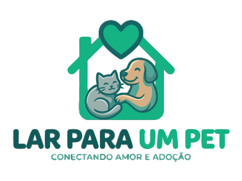

  

  # Lar Para Um Pet 🐾

  **Uma rede de amor, cuidado e proteção animal.**

  Uma iniciativa independente, gratuita e sem fins lucrativos, criada para aproximar pessoas, ONGs, protetores e iniciativas que fazem a diferença na vida dos animais.

  
  

---

## 💚 Sobre o projeto

O **Lar Para Um Pet** nasceu da vontade de utilizar a tecnologia como uma ferramenta de apoio à causa animal.

A proposta vai além de encontrar um lar para cães e gatos: queremos construir um espaço que facilite a conexão entre quem precisa de ajuda e quem pode ajudar. Acreditamos que ações colaborativas, informação acessível e ferramentas digitais podem contribuir para a adoção responsável, a proteção e o bem-estar animal.

O projeto está sendo desenvolvido **sem fins lucrativos**, com o propósito de gerar impacto social positivo.

## 🎯 Nossa missão

**Conectar pessoas e iniciativas para promover a proteção, o cuidado e novas oportunidades aos animais.**

Queremos reunir, em um único ambiente, recursos que apoiem adotantes, ONGs, protetores independentes, voluntários e toda a comunidade comprometida com o bem-estar animal.

## 🐶 Como queremos ajudar

As frentes de atuação planejadas incluem:

| Frente | Nosso objetivo |
| :--- | :--- |
| 🏡 **Adoção responsável** | Aproximar animais que precisam de um lar de pessoas dispostas a oferecer cuidado e compromisso. |
| 🔎 **Animais perdidos e encontrados** | Facilitar a divulgação de informações que ajudem famílias a reencontrar seus pets. |
| 🛡️ **Proteção animal** | Disponibilizar orientações e facilitar o acesso a canais competentes para denúncias de maus-tratos. |
| ❤️ **Apoio a ONGs e protetores** | Dar visibilidade a organizações e iniciativas que atuam na proteção animal. |
| 🤝 **Voluntariado e lares temporários** | Aproximar pessoas que desejam contribuir de quem precisa de apoio. |
| 🎁 **Doações e solidariedade** | Facilitar a divulgação de necessidades e iniciativas de arrecadação em benefício dos animais. |

> **Importante:** essas são funcionalidades previstas para a plataforma. A disponibilidade e o formato de cada recurso podem mudar ao longo do desenvolvimento.

## 🌱 Nossos princípios

- **Bem-estar animal em primeiro lugar:** incentivar o cuidado, o respeito e a adoção responsável.
- **Acesso gratuito:** construir uma ferramenta inclusiva para a comunidade.
- **Sem fins lucrativos:** orientar o projeto pelo impacto social, não pela geração de lucro.
- **Colaboração:** aproximar pessoas, organizações e iniciativas comprometidas com a causa.
- **Responsabilidade e transparência:** comunicar com clareza o que o projeto faz, o que ainda está sendo desenvolvido e seus limites.
- **Privacidade e segurança:** tratar com cuidado os dados de pessoas e organizações que venham a utilizar a plataforma.

## 🚧 Em desenvolvimento

O **Lar Para Um Pet ainda está em construção**. Estamos trabalhando para transformar essa ideia em uma plataforma útil, acessível e confiável.

Neste momento, as funcionalidades de cadastro, adoção e doações **ainda não estão disponíveis ao público**. Anunciaremos a abertura da plataforma quando ela estiver preparada para uso.

O código-fonte da aplicação é mantido em repositórios privados. Este perfil público existe para apresentar o propósito e a evolução institucional do projeto.

## 🌐 Acompanhe o projeto

**Endereço previsto para a plataforma:** `larparaumpet.com.br`

Assim que o site oficial estiver publicado, este perfil poderá incluir o link de acesso e novidades do lançamento.

---

  <strong>Todo animal merece amor, cuidado e proteção.</strong>

   

  Lar Para Um Pet · Tecnologia a serviço da causa animal · Projeto sem fins lucrativos

